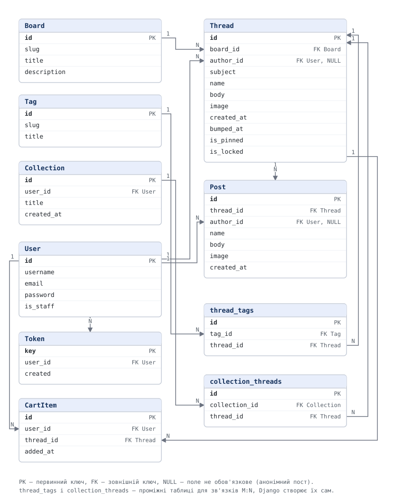

# Nullboard

Анонімний форум у стилі іміджбордів для технічних спільнот:
дошки за темами, треди з постами та картинками, модерація, добірки збережених
тредів.

## Ідея

Nullboard — це місце, де люди обговорюють технічні теми без реєстрації та
без репутації. Сайт поділений на **дошки** за темами: `/sec/`
для безпеки, `/cyb/` для кіберу, `/prog/` для програмування, `/tech/`
для заліза. У кожній дошці відкривають **треди** — обговорення з одним
заголовком. Усередині треда пишуть **пости**; перший із них, яким і відкрили
тред, називають **OP** (від original post). Коли надходить нова відповідь, тред
піднімається нагору стрічки, тому найживіші обговорення завжди зверху.

Головна відмінність від звичайного форуму — анонімність. Щоб написати, не
треба створювати акаунт: достатньо відкрити тред і залишити пост. Пости можуть
мати картинку. Якщо людина все ж зареєструвалась, під її постами видно нік, а
порожнє поле імені дає випадковий підпис на кшталт «Анонім 7f3a».

Акаунт потрібен для трьох речей:

- **профіль** — видно, які треди і пости належать тобі;
- **добірки** — можна скласти собі набір тредів, до яких хочеться повернутися;
- **модерація** — керування дошками, закріплення, закриття і видалення.

Сторінки сайту:

| Сторінка | Що на ній |
|---|---|
| Головна | стрічка тредів усіх дощок із пошуком, фільтрами й сортуванням |
| Дошка | усі треди однієї дошки |
| Тред | OP і всі відповіді, форма швидкої відповіді |
| Дошки | список усіх дощок з описами |
| Автор | публічний профіль: треди і пости людини |
| Профіль | мої дані, мої пости, мої добірки, кошик |
| Про сайт | правила спільноти, контакти адміністрації |

## Як це влаштовано

Бекенд — Django разом із Django REST Framework. Він віддає лише дані у форматі
JSON і не будує HTML-сторінок. Клієнт — окремий застосунок, який звертається до
ендпоінтів, описаних нижче. Завдяки такому розділенню сервіс працює не лише з
браузера, а з будь-якого клієнта, який уміє робити HTTP-запити.

## REST API

### Загальні домовленості

- Базовий шлях: `/api/v1/`. Версія в шляху потрібна, щоб нові зміни можна було
  додавати, не ламаючи тих, хто вже користується попередньою.
- Формат тіла запиту і відповіді: **JSON** (`Content-Type: application/json`).
  Картинки в тредах і постах поки не підтримуються, див. «Поки не реалізовано».
- Авторизація (поки не реалізована): **токен**. `POST /api/v1/auth/login/`
  повертатиме ключ, далі клієнт надсилатиме його в заголовку
  `Authorization: Token <ключ>`. Сервер не зберігатиме нічого про попередні
  запити: ні сесій, ні cookie, ні CSRF. Кожен запит нестиме все, що потрібно
  для перевірки прав. Доки авторизації немає, усі ендпоінти нижче відкриті.
- Сортування: параметр `ordering`, знак мінус означає «спадання».
- Помилки мають однаковий формат для всіх ендпоінтів. Текст завжди лежить у
  `message`. Якщо помилка стосується конкретних полів, поруч є `fields`: для
  кожного поля список усіх його помилок.

| Код | Коли | Тіло |
|---|---|---|
| `400` | некоректні дані | `{"message": "Invalid input.", "fields": {"subject": ["This field is required."]}}` |
| `400` | тіло запиту не є коректним JSON | `{"message": "JSON parse error - ..."}` |
| `404` | об'єкта немає | `{"message": "No Thread matches the given query."}` |
| `405` | метод не підтримується цим ендпоінтом | `{"message": "Method \"PUT\" not allowed."}` |
| `409` | конфлікт: запит правильний, але суперечить поточному стану | `{"message": "Thread #12 is locked. New replies are not allowed."}` |

Чому `409`, а не `400`: у цих випадках самі дані правильні, проблема в тому,
що вже лежить на сервері (код зайнятий, тред закритий, теґ використовується).
Клієнт може виправити ситуацію, лише змінивши стан, а не формат запиту.

### Дошки

| Метод | Шлях | Що робить і де використовується | Запит | Відповідь |
|---|---|---|---|---|
| `GET` | `/api/v1/boards/` | усі дошки. Хедер сайту і сторінка «Дошки» | — | `200` `[{"slug": "sec", "title": "Security", "description": "...", "thread_count": 12}]` |
| `GET` | `/api/v1/boards/{slug}/` | одна дошка. Сторінка дошки | — | `200` об'єкт дошки, `404` |
| `POST` | `/api/v1/boards/` | створити дошку. Модерація | `{"slug", "title", "description"?}` | `201` об'єкт, `400`, `409` якщо код уже зайнятий |
| `PATCH` | `/api/v1/boards/{slug}/` | змінити назву чи опис. Модерація. Код дошки не редагується, бо він входить в адресу | `{"title"?, "description"?}` | `200`, `400` якщо спробувати змінити код, `404` |
| `DELETE` | `/api/v1/boards/{slug}/` | видалити дошку разом із тредами. Модерація | — | `204`, `404` |

### Треди

| Метод | Шлях | Що робить і де використовується | Запит | Відповідь |
|---|---|---|---|---|
| `GET` | `/api/v1/threads/` | стрічка тредів. Головна сторінка | `?ordering=` | `200` `[{...}, ...]`, `400` якщо поле сортування невідоме |
| `POST` | `/api/v1/threads/` | відкрити тред. Форма «Новий тред». Вхід не потрібен | `{"board", "subject", "body", "name"?, "tags"?[]}` | `201` об'єкт, `400` (зокрема якщо такої дошки чи теґу немає) |
| `GET` | `/api/v1/threads/{id}/` | тред разом з OP. Сторінка треда | — | `200`, `404` |
| `PATCH` | `/api/v1/threads/{id}/` | редагувати тред: заголовок, текст, теґи, закріплення і закриття. Перенести тред в іншу дошку не можна | `{"subject"?, "body"?, "name"?, "tags"?[], "is_pinned"?, "is_locked"?}` | `200`, `400`, `404` |
| `DELETE` | `/api/v1/threads/{id}/` | видалити тред з усіма постами | — | `204`, `404` |

Об'єкт треда:

```json
{"id": 12, "board": "sec", "name": "", "subject": "...", "body": "...",
 "tags": ["malware"], "is_pinned": false, "is_locked": false,
 "reply_count": 3, "created_at": "...", "bumped_at": "..."}
```

Сортування стрічки, параметр `ordering`: `bumped_at`, `created_at`, `reply_count`.
За замовчуванням `-bumped_at`.

`bumped_at` — це колонка в треді: час останньої відповіді. Новий пост оновлює
її, і тред піднімається нагору стрічки. `reply_count` окремої колонки не має, це
кількість постів у треді, яку база рахує під час запиту. Так само, як
`thread_count` у списку дощок.

Типові комбінації, які використовує клієнт:

- головна за замовчуванням — `?ordering=-bumped_at`, тобто найактивніші зверху;
- «найсвіжіші» — `?ordering=-created_at`;
- «найбільш обговорювані» — `?ordering=-reply_count`.

### Пости

| Метод | Шлях | Що робить і де використовується | Запит | Відповідь |
|---|---|---|---|---|
| `GET` | `/api/v1/threads/{id}/posts/` | відповіді треда без OP, від старіших до новіших. Сторінка треда | — | `200` `[{"id", "thread", "name", "body", "created_at"}, ...]`, `404` |
| `POST` | `/api/v1/threads/{id}/posts/` | відповісти в треді. Форма швидкої відповіді | `{"body", "name"?}` | `201`, `400`, `404`, `409` якщо тред закрито |
| `GET` | `/api/v1/posts/{id}/` | один пост | — | `200`, `404` |
| `PATCH` | `/api/v1/posts/{id}/` | редагувати пост | `{"body"?, "name"?}` | `200`, `400`, `404` |
| `DELETE` | `/api/v1/posts/{id}/` | видалити пост | — | `204`, `404` |

### Акаунти і профілі (поки не реалізовано)

| Метод | Шлях | Що робить і де використовується | Запит | Відповідь |
|---|---|---|---|---|
| `POST` | `/api/v1/auth/register/` | реєстрація. Сторінка «Реєстрація» | `{"username", "email", "password"}` | `201` профіль, `400` |
| `POST` | `/api/v1/auth/login/` | вхід. Сторінка «Вхід». Повертає ключ, яким клієнт користуватиметься далі | `{"username", "password"}` | `200` `{"token": "...", "user": {...}}`, `400` |
| `POST` | `/api/v1/auth/logout/` | вихід. Кнопка в хедері. Видаляє ключ із бази, тож він більше не працює | — | `204`, `401` |
| `GET` | `/api/v1/auth/me/` | хто зараз увійшов. Хедер і профіль | — | `200` профіль, `401` |
| `PATCH` | `/api/v1/auth/me/` | редагувати свої дані. Сторінка профілю | `{"email"?, "first_name"?, "last_name"?, "password"?}` | `200`, `400`, `401` |
| `GET` | `/api/v1/users/{id}/` | публічний профіль автора | — | `200` `{"id", "username", "thread_count", "post_count", "date_joined"}`, `404` |
| `GET` | `/api/v1/users/{id}/threads/` | треди автора. Сторінка автора | `?page=` | `200` `{"count", "next", "previous", "results": [...]}`, `404` |
| `GET` | `/api/v1/users/{id}/posts/` | пости автора. Сторінка автора | `?page=` | `200` `{"count", "next", "previous", "results": [...]}`, `404` |

### Кошик і добірки (поки не реалізовано)

Кошик — це звичайний ресурс у базі, а не стан сесії. Він потрібен, щоб зібрати
кілька тредів, а потім зберегти їх однією дією. Кошик належить користувачу, тож
кожен запит до нього потребує токена.

| Метод | Шлях | Що робить і де використовується | Запит | Відповідь |
|---|---|---|---|---|
| `GET` | `/api/v1/cart/` | вміст кошика. Панель «Зберегти добірку» | — | `200` `{"threads": [...], "count": 3}` |
| `POST` | `/api/v1/cart/items/` | додати тред у кошик. Кнопка на сторінці треда | `{"thread_id"}` | `201`, `409` якщо вже є, `404` |
| `DELETE` | `/api/v1/cart/items/{thread_id}/` | прибрати тред з кошика | — | `204` |
| `GET` | `/api/v1/collections/` | мої добірки. Сторінка профілю | — | `200`, `401` |
| `POST` | `/api/v1/collections/` | зберегти кошик як добірку. Кнопка «Зберегти добірку» | `{"title", "thread_ids"?[]}` | `201`, `400`, `401` |
| `GET` | `/api/v1/collections/{id}/` | одна добірка з тредами | — | `200`, `403`, `404` |
| `PATCH` | `/api/v1/collections/{id}/` | перейменувати або змінити склад | `{"title"?, "thread_ids"?[]}` | `200`, `403`, `404` |
| `DELETE` | `/api/v1/collections/{id}/` | видалити добірку | — | `204`, `403`, `404` |

Якщо `thread_ids` не передано, добірка бере вміст кошика і очищає його.

### Теґи

| Метод | Шлях | Що робить і де використовується | Запит | Відповідь |
|---|---|---|---|---|
| `GET` | `/api/v1/tags/` | усі теґи. Випадаючий список фільтрів | — | `200` `[{"slug": "malware", "title": "Malware"}]` |
| `GET` | `/api/v1/tags/{slug}/` | один теґ | — | `200`, `404` |
| `POST` | `/api/v1/tags/` | створити теґ. Модерація | `{"slug", "title"}` | `201`, `400`, `409` якщо код уже зайнятий |
| `PATCH` | `/api/v1/tags/{slug}/` | редагувати теґ. Модерація. Код теґу не редагується | `{"title"}` | `200`, `400`, `404` |
| `DELETE` | `/api/v1/tags/{slug}/` | видалити теґ. Модерація | — | `204`, `404`, `409` якщо теґ ще стоїть на тредах |

## Схема бази даних



Таблиці та зв'язки:

| Таблиця | Що зберігає |
|---|---|
| `Board` | дошка: короткий код, назва, опис |
| `Thread` | тред: дошка, автор, заголовок, текст OP, картинка, час створення, час останнього підняття, мітки «закріплено» і «закрито» |
| `Post` | відповідь у треді: тред, автор, текст, картинка, час |
| `Tag` | теґ для фільтрів |
| `Collection` | добірка збережених тредів, належить користувачу |
| `CartItem` | тред, який користувач додав у кошик |
| `User` | стандартна модель користувача Django |
| `Token` | ключ, яким клієнт підтверджує, що він уже увійшов |

Зв'язки:

- `Thread.board` → `Board` — багато тредів в одній дошці;
- `Thread.author` → `User` — автор може бути відсутнім, тоді тред анонімний;
- `Post.thread` → `Thread` — багато постів в одному треді;
- `Post.author` → `User` — так само може бути відсутнім;
- `Thread.tags` ↔ `Tag` — багато-до-багатьох, проміжну таблицю створює Django;
- `Collection.user` → `User` — добірка належить одному користувачу;
- `Collection.threads` ↔ `Thread` — багато-до-багатьох;
- `CartItem.user` → `User` і `CartItem.thread` → `Thread` — що саме людина
  зібралася зберегти;
- `Token.user` → `User` — один або кілька ключів на користувача.

Оскільки OP зберігається в треді, а не як окремий пост, у `Thread` є поля
`body` та `image`.

Схема описує повну версію. Зараз у коді є таблиці `Board`, `Thread`, `Post` і
`Tag`; поля `author` та `image`, а також `Collection`, `CartItem` і `Token`
з'являться разом з авторизацією та картинками.

## Поки не реалізовано

Перенесено на наступні етапи:

- авторизація, акаунти, профілі і права: хто може редагувати й видаляти
  (`401`, `403`, «лише автор або модерація»);
- кошик і добірки;
- картинки в тредах і постах (`multipart/form-data`);
- пошук і фільтри стрічки: `?search=`, `?board=`, `?tag=`, `?is_pinned=`,
  `?is_locked=`;
- пагінація: `?page=` і відповідь `{"count", "next", "previous", "results"}`.
  Зараз списки повертаються повністю, звичайним масивом.

## Поки не вирішено

- Захист від спаму при анонімних постах. Потрібен або капча, або обмеження
  частоти за IP.
- Пошук через `icontains` працює повільно на великих таблицях. Якщо даних
  стане багато, треба повнотекстовий пошук.
- Де зберігати картинки — на диску сервера чи в об'єктному сховищі.

## Як запустити проєкт

Потрібен Python 3.12, 3.13 або 3.14. Усі команди виконуються з кореня
репозиторію, поруч із `manage.py`.

1. Створити й активувати віртуальне оточення:

   ```bash
   python -m venv .venv
   source .venv/bin/activate        # Windows: .venv\Scripts\activate
   ```

2. Встановити залежності:

   ```bash
   python -m pip install -r requirements.txt
   ```

   Для перевірки стилю коду потрібні ще інструменти розробки:
   `python -m pip install -r requirements-dev.txt`, далі
   `python check_submission.py`.

3. Створити базу даних:

   ```bash
   python manage.py migrate
   ```

4. Запустити сервер:

   ```bash
   python manage.py runserver
   ```

API буде доступне за адресою `http://127.0.0.1:8000/api/v1/`, наприклад
`http://127.0.0.1:8000/api/v1/boards/`. Запити з браузера дозволено лише
фронтенду з `http://localhost:3000` і `http://127.0.0.1:3000` (CORS).

## Postman

Колекція `postman/nullboard.postman_collection.json` (формат Collection v2.1)
покриває всі ендпоінти: для кожного є успішний запит і запити з помилками
(`400`, `404`, `405`, `409`). Адреса сервера винесена в змінну колекції
`base_url`, за замовчуванням `http://127.0.0.1:8000/api/v1`.

Щоб запустити: імпортувати файл у Postman (**Import**) і виконати колекцію
цілком (**Run collection**). Запити йдуть по черзі: пізніші використовують
об'єкти, створені раніше, а тека `Cleanup` видаляє все створене. Кожен запит
перевіряє очікуваний код відповіді.
